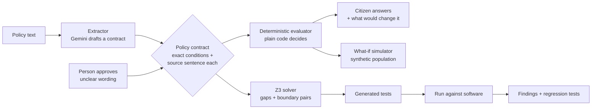

# Policy Wind Tunnel

**Every answer shows the sentence that decided it.**

Public rules are written in words and run as software. Policy Wind Tunnel turns a published rule into an exact, checkable contract, then uses that one contract to answer citizens, simulate rule changes for officials, and test the software that implements the rule.

> Google Cloud AI Builder Cup 2026 · Theme: **Sustainability & Social Impact** ("enabling more informed and sustainable decision-making")

| | |
|---|---|
| **Live app** | `TODO: Cloud Run URL` |
| **Demo video (under 3 min)** | `TODO: public video URL` |
| **Pitch deck (PDF)** | `TODO: link` |
| **Run it locally** | [Quick start](#quick-start) |

<!-- screenshot: docs/images/landing.png and docs/images/result.png go here once captured -->

## The problem

A welfare rule is a paragraph. Someone turns it into code, and nobody can easily check the two still agree. Citizens get a yes or no with no reason. Officials changing a threshold cannot see who it moves. Software testers write a handful of examples and miss the edges.

`TODO: add one quantified, sourced statistic about exclusion errors in public schemes. None has been verified yet, so none is stated here.`

## What it does

**For citizens** (`/citizen`)
- **Do I qualify?** One question per screen, then a result that leads with the answer and highlights the exact published sentence that decided it, with its source and date.
- **What would change my answer?** A solver finds the smallest change that would alter the result, never suggesting a fixed fact such as age, and re-checks it with the real evaluator before showing it.
- **Who handles my problem?** Describe it in your own words and get the right office, helpline and next step, each with a source.
- **My rights**, **how government is organised**, and **My area**: live web search of representatives and local bodies, with every fact linked to its page.

**For officials** (`/officials`)
- **What if we change a rule?** Re-decide thousands of synthetic applicants under a proposed rule and see who moves, which rejection reasons change, and which software tests would now fail.
- **Test the software.** For each condition in the rule it builds two nearly identical people on either side of the line and checks the implementation agrees. Failures are clustered, quoted against the policy clause, and turned into regression tests that fail on the bug and pass on the fix.
- **Benchmark.** Generated tests against hand-written tests on ten planted bugs.

## How it works



1. **Contract.** A policy becomes a list of exact conditions, each keeping the sentence it came from. A restricted expression language (no `eval`, no function calls, integers only) keeps the evaluator auditable.
2. **Approval.** Unclear wording is listed as an ambiguity. A person decides what it means, and findings under an unapproved ambiguity are reported as "needs clarification", not as bugs.
3. **One engine, three jobs.** The same evaluator answers citizens, runs the what-if, and acts as the oracle for software tests.
4. **Solver.** Z3 proves the contract has no gap (every input is decided) and no dead rule, and builds the boundary test pairs.
5. **The model never decides.** Gemini may draft a contract or run a web search. Plain code evaluates the contract, and every quoted rule must appear verbatim in the policy text.

## Google Cloud and AI usage

| Piece | Where | Why |
|---|---|---|
| Gemini (`gemini-2.5-flash`) | `agents/llm.py`, `agents/extractor.py`, `agents/critic.py` | Drafts a contract from policy text, with a repair loop that feeds validation errors back. Every rule must quote the policy verbatim or it is rejected. |
| Gemini with Google Search grounding | `civic/research.py` | Live lookup of representatives and local bodies in two steps: a grounded free-text search, then a structuring call that may cite only sites the search returned. Each person gets only the pages the search tied to their own entry. Social media and aggregator sites are never cited. |
| Cloud Run | not deployed yet | Planned host for the FastAPI service. `TODO: add a Dockerfile and deploy notes, then update this row.` |
| Z3 | `adversary/symbolic.py`, `adversary/mcdc.py` | Gap and dead-rule checks, boundary-pair test generation, and the minimal-change search. |

`TODO: Agent Development Kit is a dependency but the extractor, critic and triager are not yet wired as ADK agents.`

## Evidence

Measured by the benchmark in `evaluation/harness.py`, and shown live on the landing page.

| | Generated from the contract | Hand-written suite |
|---|---|---|
| Planted bugs caught (of 10) | **10 (100%)** | **4 (40%)** |
| Tests | 56 | 16 |
| False alarms on the correct software | 0 | n/a |
| Regression tests valid (fail on bug, pass on fix) | 100% | n/a |

Other checks: **384 automated tests**. The contract evaluator agrees with the reference engine on 30,000 random inputs. The "smallest change" search is compared against a brute-force scan.

**Read this honestly.** The ten planted bugs, the hand-written suite and the generator were all written by the same team, so this shows recall on known kinds of bug, not on unknown ones. The generator has not been run against third-party software yet.

## Quick start

Requires Python 3.12 and [uv](https://docs.astral.sh/uv/).

```bash
git clone <this repo> && cd policy-wind-tunnel
uv sync
uv run policy-wind-tunnel            # http://127.0.0.1:8000
uv run pytest                        # 384 tests
```

It runs without any key. Gemini features are off until you add credentials.

### Configure Gemini

```bash
cp .env.example .env
```

Edit `.env` and set **one** of:

```bash
# Option 1: API key from https://aistudio.google.com/apikey
GOOGLE_API_KEY=your-key

# Option 2: Vertex AI (run `gcloud auth application-default login` first)
GOOGLE_GENAI_USE_VERTEXAI=true
GOOGLE_CLOUD_PROJECT=your-project-id
GOOGLE_CLOUD_LOCATION=us-central1
```

| Variable | Meaning | Default |
|---|---|---|
| `GOOGLE_API_KEY` | Gemini API key | unset |
| `GOOGLE_GENAI_USE_VERTEXAI`, `GOOGLE_CLOUD_PROJECT` | Use Vertex AI instead of a key | unset |
| `PWT_MODEL` | Model for contract drafting and live lookup. Tested with the default; other models may not honour the search tool | `gemini-2.5-flash` |
| `PWT_LIVE_LEADERS` | `0` turns off live web-search lookup | `1` |

`.env` is git-ignored. Real environment variables always win over the file. Check what the app picked up at `/api/health`, which shows the model and the credential mode but never the key.

## Pages

| Path | Page |
|---|---|
| `/` | Landing page with a live checker |
| `/citizen` | Qualify, find the right office, rights, area lookup |
| `/officials` | Policy contract, what-if, software test, benchmark |
| `/about` | How it works, coverage by country, limits |

## Coverage

Content was read from official pages on 13 October 2026. Anything that could not be opened is left out or marked, never filled in from memory.

| Country | Self-check schemes | Status |
|---|---|---|
| Singapore | Silver Support Scheme, Legal Aid Bureau Means Test | partial |
| India | PM Ujjwala (PMUY 2.0) | partial |
| Australia, Philippines, Indonesia | none (thresholds could not be verified) | partial |

## How this maps to the judging criteria

| Criterion | Where to look |
|---|---|
| **Technical merit and Gen AI implementation (40%)** | Extractor with repair loop and verbatim-quote grounding (`agents/`), Z3 gap checks and boundary generation (`adversary/`), grounded web search with source filtering (`civic/research.py`), benchmark (`evaluation/`), 384 tests |
| **Problem alignment and impact (25%)** | Citizen result pages with the deciding sentence and "what would change my answer"; officials' what-if showing who a change moves |
| **Innovation and creativity (25%)** | One contract powering three jobs; solver-verified smallest-change search; regression tests proven to fail on the bug and pass on the fix |
| **UX and solution design (10%)** | One question per screen, plain-language results, skip links, visible focus, contrast checked to WCAG AA, phone layout |

## Limitations

- **Not an official decision.** Results are indicative. The issuing office decides.
- **Bundled people are fictional.** Live lookup can name real representatives. Those results are a web search that no person has reviewed. Every fact links to its page, and anything without a matching source is left out. It never shows assets, criminal cases or contact details, and it refuses to rate or rank anyone.
- **Gemini was run for real, once per feature, on `gemini-2.5-flash`.** Contract extraction produced a 10-rule contract on the first attempt that agreed with the hand-written contract on 88.2% of 6,000 inputs after field names were mapped by hand. The remaining differences were the same decision with a duplicated reason, which is now removed. This was a single run, not a distribution.
- **Live lookup varies between runs.** Searching the same place three times found 5, 8 and 5 people. People with no trustworthy page are left out and named as left out. Role, party and handles come from the search notes, never from the model's memory.
- **Sources support a person's entry as a whole, not each sentence.** No fact was checked against a specific page.
- **The population is synthetic.** What-if percentages show how the mechanism works. They are not forecasts, and no behaviour is predicted.
- **The benchmark is self-made**, as described above.
- **Coverage is partial.** Several countries have few verified entries, and the citizen pages say which parts are unverified.
- **Nothing you enter is stored.**

## Project layout

```
src/policy_wind_tunnel/
  contract/     expression language, schema, evaluator, gold contract
  adversary/    Z3 symbolic contract, boundary-pair generator
  agents/       Gemini client, extractor, critic, approval gate
  pipeline/     runner, triage, regression-test emitter
  simulation/   what-if scenarios and synthetic population
  civic/        country packs, scheme contracts, smallest-change search, live lookup
  benchmark/    fictional lending policy, reference engine, planted bugs, baseline
  evaluation/   benchmark harness
  service/      FastAPI app, pages (static/)
  settings.py   .env loading and model/credential reporting
tests/
```

## Built during the hackathon

All code in this repository was written during the hackathon window, and the commit history shows it. Third-party libraries are used as declared dependencies only: FastAPI, Pydantic, Hypothesis, Z3, the Google GenAI SDK and Google ADK.

## Team

`TODO: names and roles`

## Licence

`TODO: choose a licence before the repository is made public.`
